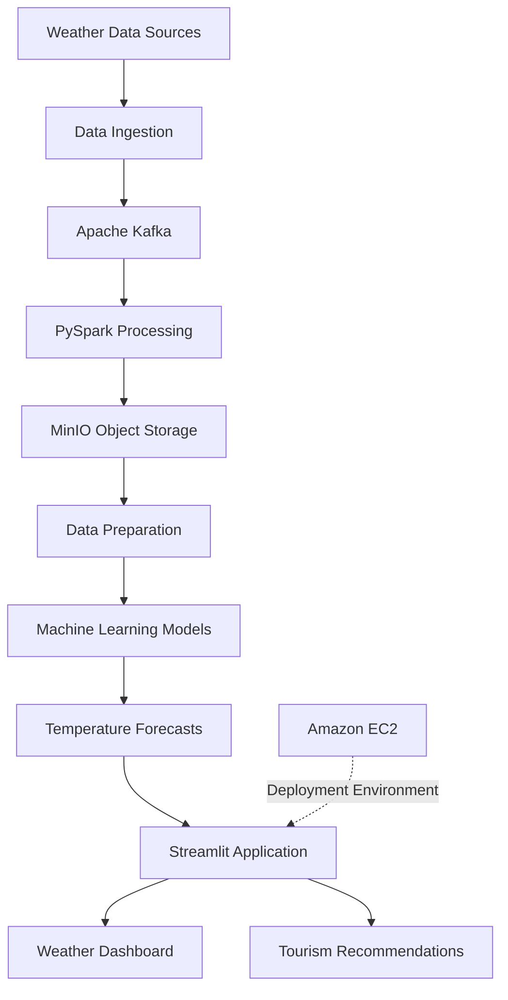

# Real-Time Weather Forecasting & Tourism Recommendation System

A Big Data project that combines weather forecasting and tourism recommendation for major cities in Vietnam. The project integrates data ingestion, distributed data processing, object storage, machine learning, and interactive visualization into a data pipeline.

The system uses **Apache Kafka, PySpark, MinIO, Python, and Streamlit**, with cloud deployment on Amazon EC2.

## Table of Contents

- [Project Overview](#project-overview)
- [Project Objectives](#project-objectives)
- [System Architecture](#system-architecture)
- [Technology Stack](#technology-stack)
- [Key Features](#key-features)
- [Data Processing Workflow](#data-processing-workflow)
- [Machine Learning](#machine-learning)
- [Project Structure](#project-structure)
- [Installation and Setup](#installation-and-setup)
- [Dataset](#dataset)
- [Results and Applications](#results-and-applications)
- [Limitations and Future Improvements](#limitations-and-future-improvements)
- [Team and Contributions](#team-and-contributions)

## Project Overview

Weather conditions can significantly influence travel decisions and tourism activities. This project explores how Big Data technologies can be used to process weather data, generate temperature forecasts, and provide tourism recommendations for different destinations in Vietnam.

The project combines historical weather data with a data pipeline built around Kafka, PySpark, and MinIO. Machine learning models are used to predict temperature, while a Streamlit application presents weather information and destination recommendations through an interactive interface.

The project covers several stages of a data engineering workflow, including data ingestion, processing, storage, model development, and application deployment.

## Project Objectives

- Build a data pipeline for handling weather data.
- Explore real-time data ingestion using Apache Kafka.
- Process and transform data using PySpark.
- Store data using MinIO object storage.
- Develop machine learning models for temperature forecasting.
- Provide weather-based tourism recommendations.
- Build an interactive dashboard using Streamlit.
- Deploy the application in a cloud environment using Amazon EC2.

## System Architecture

The project follows a pipeline-oriented architecture connecting data ingestion, processing, storage, prediction, and visualization.



**Architecture overview:**

1. **Data Sources:** Weather data is collected or loaded from the project's data sources.
2. **Data Ingestion:** Weather data is prepared for processing and streaming.
3. **Kafka:** Supports the data streaming workflow.
4. **PySpark:** Processes and transforms weather data.
5. **MinIO:** Provides object storage for data used in the pipeline.
6. **Machine Learning:** Generates temperature predictions using trained models.
7. **Streamlit:** Presents forecasts and tourism recommendations through an interactive application.
8. **Amazon EC2:** Provides the cloud environment used to deploy the application.

*Note: The diagram presents the project's high-level architecture. The actual implementation details may differ between individual notebooks and application components.*

## Technology Stack

| Category | Technologies | Purpose |
|---|---|---|
| Programming Language | Python | Data processing, model development, and application logic |
| Data Streaming | Apache Kafka | Data ingestion and streaming workflows |
| Big Data Processing | PySpark | Data transformation and distributed processing |
| Object Storage | MinIO | Storing and accessing data objects |
| Machine Learning | Scikit-learn, XGBoost, LightGBM | Temperature forecasting |
| Data Visualization | Streamlit | Interactive application and dashboard |
| Cloud Infrastructure | Amazon EC2, Ubuntu | Cloud deployment environment |
| Development Tools | Jupyter Notebook, PuTTY, FileZilla | Experimentation and remote server management |

*The exact libraries and tools required to run the application should be verified against the project's source code and dependency files.*

## Key Features

### 1. Weather Data Processing

- Work with historical weather data.
- Prepare and transform data for analysis and model development.
- Explore streaming data workflows using Kafka.
- Process data with PySpark and integrate object storage through MinIO.

### 2. Temperature Forecasting

- Develop machine learning models for temperature prediction.
- Experiment with different algorithms.
- Evaluate model performance using regression metrics.
- Present forecast results through an interactive interface.

### 3. Tourism Recommendation

- Provide tourism destination recommendations for selected cities in Vietnam.
- Combine weather forecasts with destination information.
- Help users explore destinations based on available weather information.

### 4. Interactive Application

- Display weather forecasts and relevant information.
- Allow users to explore supported destinations.
- Present tourism recommendations in a user-friendly interface.
- Integrate forecasting results into the Streamlit application.

### 5. Cloud Deployment

- Use an Ubuntu environment on Amazon EC2.
- Configure the environment required to run the application.
- Access the deployed application through a browser when the service is running and its network settings permit access.

## Data Processing Workflow

The project can be understood through the following workflow.

### Step 1: Data Collection

Collect or load historical weather data from the sources used in the project.

The dataset is prepared for subsequent data processing and model development.

### Step 2: Data Ingestion

Use Apache Kafka to explore the ingestion and streaming of weather data.

This stage supports the movement of data through the pipeline.

### Step 3: Data Processing

Use PySpark to process and transform weather data into a format suitable for downstream tasks.

Potential processing operations include:

- Data cleaning and preparation.
- Handling missing or inconsistent values.
- Transforming features.
- Preparing datasets for model training and prediction.

The exact operations depend on the implementation in the notebooks.

### Step 4: Data Storage

Use MinIO as object storage within the data pipeline.

The project includes a notebook dedicated to the MinIO workflow.

### Step 5: Model Development

Train and evaluate machine learning models using the prepared weather data.

Compare model performance to identify a suitable forecasting approach.

### Step 6: Application Development

Use Streamlit to present forecast results and tourism recommendations.

### Step 7: Deployment

Run the application in the configured cloud environment using Amazon EC2 and Ubuntu.

## Machine Learning

The project explores machine learning techniques for temperature forecasting.

The models associated with the project include:

- Random Forest
- XGBoost
- LightGBM

The forecasting workflow involves preparing input features, training models, generating predictions, and evaluating performance.

### Evaluation Metrics

Common regression metrics for this task include:

| Metric | Purpose |
|---|---|
| RMSE | Measures the typical magnitude of prediction errors, with greater sensitivity to large errors |
| MAE | Measures the average absolute difference between predicted and actual values |
| R² | Measures how much of the variation in the target variable is explained by the model |

Actual model results should be reported here after verifying the evaluation outputs in the project notebook.

## Project Structure

The repository is organized to separate application code, notebooks, documentation, and dataset information.

```text
real-time-weather-big-data-pipeline/
│
├── README.md
├── requirements.txt
├── .gitignore
│
├── app/
│   └── streamlit_app.py
│
├── notebooks/
│   ├── import_history_data.ipynb
│   ├── temperature_kafka.ipynb
│   ├── temperature_minio.ipynb
│   └── bigdata_model.ipynb
│
├── docs/
│   └── BigData_Project_Report.pdf
│
├── screenshots/
│   └── README.md
│
└── data/
    └── README.md
```

**Directory descriptions:**

- `app/`: Streamlit application code.
- `notebooks/`: Notebooks for historical data preparation, Kafka, MinIO, and model development.
- `docs/`: Project report and supporting documentation.
- `screenshots/`: Application screenshots and visual demonstrations.
- `data/`: Instructions for accessing the dataset.
- `requirements.txt`: Python dependencies required by the project.
- `.gitignore`: Files and directories excluded from version control.

*Update the structure above to match the files actually committed to the repository. For example, include the PDF report only if it is available.*

## Installation and Setup

The following instructions provide a starting point for running the application locally. Verify the dependencies, file paths, and configuration values against the actual implementation before using them.

### Prerequisites

- Python 3.10 or another version supported by the project dependencies.
- Git.
- Access to the required dataset.
- Additional services or configurations if running the Kafka and MinIO components.

### 1. Clone the Repository

```bash
git clone https://github.com/<your-github-username>/real-time-weather-big-data-pipeline.git
cd real-time-weather-big-data-pipeline
```

Replace `<your-github-username>` with your GitHub username.

### 2. Create a Virtual Environment

```bash
python -m venv .venv
```

Activate the environment.

**Windows:**

```bash
.venv\Scripts\activate
```

**macOS / Linux:**

```bash
source .venv/bin/activate
```

### 3. Install Dependencies

```bash
pip install -r requirements.txt
```

Make sure `requirements.txt` contains the dependencies needed by the application.

### 4. Configure the Data and Services

Before running the application:

- Follow the instructions in `data/README.md` to obtain the dataset.
- Configure the connection settings required by Kafka and MinIO if the application depends on those services.
- Set any required environment variables.
- Check the file paths referenced in the application code.

Do not commit passwords, access keys, API tokens, or other credentials to GitHub.

### 5. Run the Streamlit Application

If the application entry point is `app/streamlit_app.py`, run:

```bash
streamlit run app/streamlit_app.py
```

Open the local URL displayed in the terminal.

**Important:** The actual entry point may be named `app.py` or located in another directory. Adjust this command to match the committed source code.

## Dataset

The project includes a weather dataset named `Vietnam_IoT_Final_Dataset.csv`.

The dataset is approximately 181.8 MB, so it should not be uploaded directly through the standard GitHub browser upload interface.

Instead, this repository should document how to obtain the data.

Suggested contents for `data/README.md`:

- Dataset name and description.
- Original data source, if known.
- Data collection period and geographic coverage, if documented.
- Required download or access instructions.
- Expected file name and location.
- Any applicable usage or redistribution restrictions.

**Dataset source:** Add the original source or an authorized download location after verifying it.

If the dataset cannot be redistributed, provide instructions for obtaining it rather than uploading the full file. A small sample may be included if permitted and sufficient for demonstrating the workflow.

## Results and Applications

The project demonstrates how multiple technologies can be integrated into a weather data application.

Its main deliverables include:

- Notebooks exploring data ingestion and processing.
- A Kafka-related workflow.
- A MinIO-related workflow.
- Machine learning experiments for temperature forecasting.
- A Streamlit application for weather information and tourism recommendations.
- A cloud deployment environment.

To make this section more informative, add verified results from the project, such as:

- The number of records processed.
- The cities covered by the application.
- The forecasting horizon.
- The best-performing model and its evaluation metrics.
- Screenshots of the application.
- A demonstration link, if the application is publicly accessible.

Only include results that can be supported by the implementation or experimental outputs.

## Limitations and Future Improvements

Potential improvements include:

- Automating the end-to-end data pipeline.
- Improving data validation and error handling.
- Scheduling data ingestion and processing jobs.
- Monitoring pipeline execution and model performance.
- Comparing forecasting models across different cities and time periods.
- Adding more weather features and tourism destinations.
- Improving the recommendation logic and explaining why each destination is recommended.
- Containerizing the application and supporting services.
- Adding automated testing and deployment workflows.

These are possible future enhancements rather than claims about features already implemented.

## Team and Contributions

**Project:** Real-Time Weather Forecasting & Tourism Recommendation System  
**Project Type:** Academic Big Data project  
**Team:** Group 6

The project covers data processing, streaming workflows, machine learning, visualization, and cloud deployment.

### Individual Contributions

Document your own contributions here, based on the work you personally completed. For example, if accurate, you may describe involvement in:

- Weather data preparation and processing.
- Kafka and MinIO workflow development.
- Machine learning model development and evaluation.
- Streamlit application development.
- Cloud deployment and environment configuration.

Clearly distinguish your own work from tasks completed by other team members.

## Acknowledgements

This project was developed as part of an academic Big Data project.

Thanks to the team members and contributors involved in the project.

---

**Repository:** `real-time-weather-big-data-pipeline`
